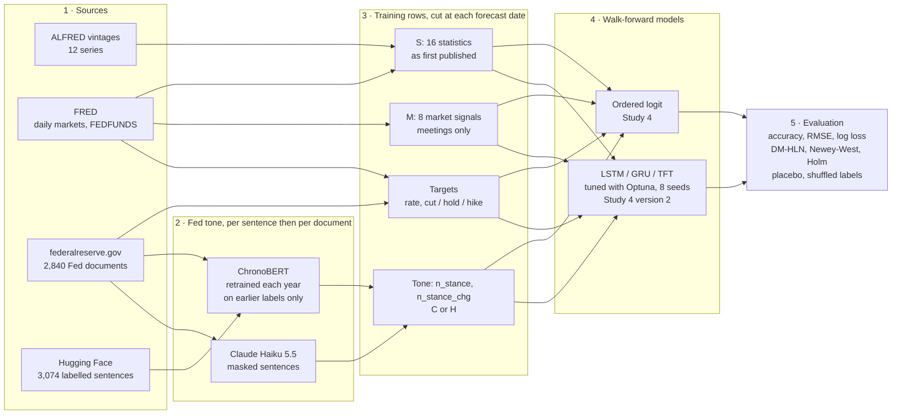

# Fed News Forecasting: the final study

**Does what the Federal Reserve says help forecast what it does?** This study tests whether the hawkish or dovish
tone of Fed communication improves out-of-sample forecasts of FOMC decisions and of the federal funds rate, beyond
the economic statistics and market interest rates that were available at the time.

This repository holds the final study (Study 4) and the studies that followed it. Each study has its own folder for
its code, tests, design documents and results. The earlier trial-and-error designs (attempts 1-5: Plan 1, Plan 2,
Plan 5, Study 2, Study 3, Study 5 and the proofs of concept), their pre-registrations, the 2026-10-13 audit and the
draft paper are in [fed-news-forecasting](https://github.com/taminggg1-cmyk/fed-news-forecasting). Commit hashes in
the Study 4 sections (b4a00fd, 7879a70, 6048e0d, 1a31c73) refer to that repository, where the date of each design
can be checked.

*Draft research, October 2026. The code, analyses and documents were written with an AI coding agent
(see [How this was made](#how-this-was-made)).*

## Short answer

- **Fed tone usually improves the forecasts a little, but rarely enough to pass the test each study declared in
  advance.** [`results/ATTEMPTS.md`](results/ATTEMPTS.md) lists every attempt, its primary test and its result; a
  p-value below 0.05 found after many attempts is weaker evidence than one found on the first.
- **Strongest result so far (attempt 12b, declared before its run).** The TFT network with the Haiku-distilled
  ChronoBERT tone beats the same network without news on the 134 scheduled meetings from 2010. Log loss falls from
  0.403 to 0.318; Newey-West p = 0.0017, Holm-adjusted over the 3 networks p = 0.0050. The tone is read by a model
  frozen at the end of 2009, so it cannot remember later decisions. Two limits: this was the declared secondary
  test (the primary ordered-logit test gave Clark-West p = 0.220), and the TFT's gain over a placebo tone is not
  significant (p = 0.082).
- **Study 4.** Only one gain is significant, LSTM + Claude Haiku on meetings (Holm p = 0.020), under an amendment
  written after the first network results, and it is not confirmed on strict real-time data.
- Not significant does not mean news fails: with about 135-210 test meetings, gains this small are hard to tell
  apart from chance.

## Studies at a glance

| Study | Attempts | Question | Documents | Code (`src/fed_news/studies/`) | Results | Primary result |
| --- | --- | --- | --- | --- | --- | --- |
| Study 4 and version 2 | 6-8 | Does ChronoBERT (C) or Haiku (H) tone help an ordered logit and tuned LSTM / GRU / TFT? | [`docs/studies/1_study4/`](docs/studies/1_study4/) | `simple_model/`, `networks/` | [`results/study4/`](results/study4/) | Ordered logit: not supported (H p = 0.144). Networks: LSTM + H Holm p = 0.020, the other 5 not significant |
| CORAL study | 9-11 | Does an ordinal tone (ChronoBERT-CORAL "Co", Haiku ordinal "Ho") help, with CORAL networks? | [`docs/studies/2_coral/`](docs/studies/2_coral/) | `coral/` | [`results/coral/`](results/coral/) | Not supported: logit Ho Holm p = 0.133; networks Holm p ≥ 0.145; from 2010, 0.0997 and 0.073 |
| Literature tests | exploratory | Do the tests other studies use (fixed-b, fixed-m, ranked probability score, Giacomini-White, SPA, in-sample) change the picture? | [`docs/studies/3_sigtests_distill/`](docs/studies/3_sigtests_distill/) (Part A) | `sigtests/` | [`results/sigtests/`](results/sigtests/) | No test that passes its placebo check gives p < 0.05 after Holm; closest 0.050-0.052 |
| Haiku-distilled ChronoBERT | 12, 12b | Does ChronoBERT trained on Haiku's probabilities up to 2009 (tone "Hd") help from 2010? | [`docs/studies/3_sigtests_distill/`](docs/studies/3_sigtests_distill/) (Part B) | `distill/` | [`results/distill/`](results/distill/) | Ordered logit p = 0.220 (not supported). Networks: TFT Holm p = 0.0050 against no news, p = 0.082 against its placebo |
| Text against economic data | 13 | Does tone help beyond a Taylor rule without market prices? | [`docs/studies/4_text_vs_economy/`](docs/studies/4_text_vs_economy/) | not built | none | Designed, not run |
| Tone by document type | 14 | Does splitting the distilled tone into statements, minutes and speeches (6 columns instead of 2) help? | [`docs/studies/5_doctype/`](docs/studies/5_doctype/) | `doctype/` | `results/doctype/` | Ordered logit Clark-West p = 0.0100 (supported, exploratory; placebo 0.456); split against the single tone p = 0.071. Networks running |

## Repository layout

```
src/fed_news/
  config.py       settings, and where the data folder is
  download/       everything fetched from the internet (ALFRED, FRED, Fed documents, FOMC calendar, labels, indices)
  features/       Fed tone (ChronoBERT, Haiku) and the training rows (per meeting, per month)
  models/         ordered logit, ridge, the walk-forward loop, LSTM / GRU / TFT
  evaluation/     accuracy numbers and significance tests (DM-HLN, Newey-West, McNemar, Holm, Clark-West)
  studies/        one folder per study; each writes results/<study>/
    simple_model/   Study 4 (ordered logit)
    networks/       Study 4 version 2 (tuned LSTM / GRU / TFT)
    coral/          CORAL study
    sigtests/       literature tests on the saved forecasts
    distill/        Haiku-distilled ChronoBERT
tests/
  shared/         tests of download/, features/, models/, evaluation/
  studies/        tests of each study, in folders named as in src/fed_news/studies/
docs/
  guides/         code guide, data description and manifest, technical pipeline note, deviations
  studies/        one folder per study: designs, plans, reports (README lists them)
results/
  ATTEMPTS.md     every attempt and its primary test
  study4/ coral/ sigtests/ distill/   one folder per study (README lists them)
scripts/
  download_data.py   fetch and check the training data
  audit/             why the simple model beats the networks (script and output)
```

## Quick start (Linux, macOS or Windows)

```bash
curl -LsSf https://astral.sh/uv/install.sh | sh        # install uv (Windows: see docs.astral.sh/uv)
git clone https://github.com/taminggg1-cmyk/fed-news-forecasting-final.git
cd fed-news-forecasting-final
uv sync                                                # Python 3.13 and the exact package versions (uv.lock)
uv run python scripts/download_data.py                 # the training data -> data/ (79 MB, checksums checked)
uv run pytest -q                                       # offline tests, about 1 minute
uv run python -m fed_news.studies.simple_model.run_simple_model          # Study 4, about 5 minutes
uv run python -m fed_news.studies.networks.run_networks forecast --task T2 --device cpu   # Study 4 v2 tables
```

**Where is the data?** In `data/` after the download step (the code finds it there by itself; you can also set
`FED_NEWS_DATA` to any folder). [`docs/guides/DATA.md`](docs/guides/DATA.md) describes every file, and
[`docs/guides/CODE_GUIDE.md`](docs/guides/CODE_GUIDE.md) shows where each one is downloaded from, which file builds it and which
file reads it next. **Start reading the code with `docs/guides/CODE_GUIDE.md`.** To download the raw data yourself instead
of using the zip: `uv run python -m fed_news.download` (every source, in order; needs a free FRED API key).

## Data

Every input is dated, and each training row uses only what was public before its cutoff: the day before the meeting,
or the start of the second US business day of the month. [`docs/guides/DATA.md`](docs/guides/DATA.md) describes every file.

| Input | Source | What the models see |
| --- | --- | --- |
| Economic statistics | ALFRED (St. Louis Fed), every published vintage of 12 series; FRED | 16 statistics (`s_*`, block S): 13 from ALFRED as first published (M2 monthly and yearly change, PCE and core PCE prices, payrolls, hourly earnings, GDP, U-6 monthly and yearly change, PPI, CPI, core CPI, house prices), plus the previous rate and two yield-curve slopes |
| Market signals (meetings only) | FRED daily series | 8 signals (`m_*`, block M): 3-month bill and 6-month, 1-year and 2-year yields minus the target, target level, zero-bound flag, VIX, oil |
| Fed documents | federalreserve.gov | 2,840 documents: 1,981 speeches, 263 minutes, 262 Beige Books, 240 statements, 94 press conferences. The tone readers use all but the Beige Books (2,578 documents, 343,742 sentences) |
| Human stance labels | Hugging Face: Trillion Dollar Words (`gtfintechlab/fomc_communication`) and World Central Banks (`gtfintechlab/federal_reserve_system`) | 3,074 hawkish / dovish / neutral sentences, dated by the first Fed document that contains them. Used only to train ChronoBERT |
| Targets | FOMC calendar and target rate; FRED `FEDFUNDS` | Meetings: new target rate, change, cut / hold / hike. Months: average effective fed funds rate |
| News indices (sensitivity checks only) | SF Fed news sentiment, geopolitical risk (GPR), policy uncertainty (EPU) | `n_news`, `n_gpr`, `n_epu`, and Beige Book tone `n_beige` (Loughran–McDonald) |

**Fed tone, two readers.** Both score the same sentences, and a document's tone is the mean over its sentences.

- **ChronoBERT** ([`features/chronobert_tone.py`](src/fed_news/features/chronobert_tone.py)). For each year y, the
  ChronoBERT checkpoint from year y−1 is fine-tuned on human labels dated before y (80% to train, 20% held out; 326
  training sentences for the 2000 classifier, 2,431 for 2025), with 3 seeds averaged. Sentence tone = P(hawkish) −
  P(dovish). Held-out accuracy rises from 56.0% (macro-F1 0.374) for the 2000 classifier to 70.1% (macro-F1 0.691)
  for 2025 ([`results/stance_accuracy.csv`](results/stance_accuracy.csv)).
- **Claude Haiku 5.5** ([`features/haiku_tone.py`](src/fed_news/features/haiku_tone.py)). Each sentence is masked
  (years, months, numbers, names and events hidden) and sent, 25 per request, through the Message Batches API.
  Hawkish = +1, dovish = −1, neutral = 0.

Each row's tone, `n_stance`, is the mean of three group means (statements and press conferences, minutes, speeches)
over the documents released since the previous row's cutoff, carried forward when there are none; `n_stance_chg` is
its change from the previous row. "C" and "H" mark which reader's tone a model uses.

**Rows.** Meetings: 270 rows from February 1994, of which 212 test meetings from 2001 (206 scheduled). Months: 393
rows from January 1994, of which 308 test months from 2001. Earlier rows are used only for training.

## Study 4 in detail

**Short answer for Study 4.** News improves most models: Fed tone lowers the forecast error in 12 of 14 main
comparisons (10 of 12 for the networks, and both versions of the simple model). Only one gain is statistically
significant, LSTM + Claude Haiku on meetings, and it is not confirmed on strict real-time data.

| Part | Code | Models | Tasks | Status |
| --- | --- | --- | --- | --- |
| Study 4 | `src/fed_news/studies/simple_model/` | Simple model: penalised ordered logit | Per meeting | Exploratory study; design b4a00fd committed before the first run, results 7879a70 |
| Study 4 version 2 | `src/fed_news/studies/networks/` | LSTM, GRU, TFT, tuned with Optuna inside each training window, 8 seeds | Per meeting and monthly | Dated amendment 6048e0d, written after the version 1 network results had been seen; results 1a31c73. Not a pre-registration |

**Shared design.** FOMC meetings and months, 2001–2026. Every forecast uses only information available before it:
16 economic statistics as first published (ALFRED vintages), plus 8 market signals for meetings. Fed tone is read
by ChronoBERT (retrained each year on earlier text only, so it cannot see the future) or by Claude Haiku 5.5, which
labelled 343,717 of 343,742 Fed sentences (its training data run to June 2026). Per meeting: 206 scheduled meetings, predicting
cut / hold / hike and the new target rate. Monthly: 308 months, predicting the average effective fed funds rate.
The design is in [`docs/studies/1_study4/`](docs/studies/1_study4/2026-10-12-study4-haiku-index-tuned-design.md)
(section 12 is the version 2 amendment).

## Study 4 pipeline



| Model | Input | Output | Training |
| --- | --- | --- | --- |
| Ordered logit (Study 4, meetings) | One row: S + M (24 columns), with or without the 2 tone columns, standardised on the training rows | P(cut), P(hold), P(hike). Rate = previous rate + the probability-weighted average move size | Refit for every test meeting on all earlier meetings. L2 penalty chosen from 0.01–3.0 by 5-fold expanding-window CV inside the training rows |
| LSTM, GRU (Study 4 version 2) | A sequence of the last 2, 4, 8 or 12 meetings (3, 6, 12 or 24 months). Meetings: S + M ± tone. Months: S ± tone | Rate change. Rate = previous rate + change; cut / hold / hike from a ±0.125-point band | Optuna (TPE, 20 trials) at the first test row of 2001, 2005, …, 2025, scored on 4 expanding validation folds before that point. Search: hidden size, layers, dropout, learning rate, weight decay, lookback, batch. Refit every 8 meetings or 12 months; mean of 8 seeds |
| TFT-style ([`models/tft.py`](src/fed_news/models/tft.py)) | The same tensors as the LSTM | Same as LSTM | Same as LSTM, with attention heads in place of layers. Variable selection networks, gated residual networks and interpretable multi-head attention (Lim et al., 2021); point forecast under MSE |

Each model runs in matched versions on the same rows: no news, + ChronoBERT tone (C), + Haiku tone (H) and a placebo
(tone shifted by half the sample). The ordered logit adds a shuffled-label control; the networks add the same versions
on strict data (only the 8 fully vintaged statistics). The
file-by-file version of this pipeline, with every command, is in [`docs/guides/CODE_GUIDE.md`](docs/guides/CODE_GUIDE.md).
The later studies' pipeline (CORAL head, distilled ChronoBERT), with tensor shapes, is in
[`docs/guides/PIPELINE_TECHNICAL.md`](docs/guides/PIPELINE_TECHNICAL.md).

## Study 4 results

**Per meeting (206 scheduled meetings, 2001–2026): decisions called correctly, with p for the news versions**

| Model | No news | + ChronoBERT | + Haiku |
| --- | --- | --- | --- |
| Simple model (ordered logit) | 86.4% | 86.9%, p 0.21 | 88.8%, p 0.14 |
| LSTM, normal data | 78.6% | 83.5%, p 0.37 | **84.5%, p 0.003 (Holm p 0.020)** |
| GRU, normal data | 80.6% | 80.1%, p 0.99 | 82.0%, p 0.20 |
| TFT, normal data | 86.4% | 85.9%, p 0.21 | 86.9%, p 0.17 |
| LSTM, strict data | 81.6% | 84.5%, p 0.47 | 85.4%, p 0.46 |
| GRU, strict data | 83.0% | 85.9%, p 0.85 | 86.4%, p 0.93 |
| TFT, strict data | 87.4% | 86.9%, p 0.94 | 87.9%, p 0.69 |

Only one gain is significant: LSTM + Haiku on normal data (RMSE 0.1420 → 0.1333 percentage points). The strict-data
accuracy gains are within chance: a 3-point gain is about 6 meetings, and the LSTM + Haiku RMSE barely moved
(0.1251 → 0.1246). For the simple model, Haiku lowers log loss by 7.4% and ChronoBERT by 4.2%.

**Monthly (308 months, 2001–2026): RMSE in percentage points, with p for the news versions**

| Model | No news | + ChronoBERT | + Haiku |
| --- | --- | --- | --- |
| "Rate stays the same" | 0.181 | | |
| LSTM, normal data | 0.188 | 0.198, p 0.88 | 0.172, p 0.026 (Holm p 0.156) |
| GRU, normal data | 0.180 | 0.178, p 0.36 | 0.178, p 0.45 |
| TFT, normal data | 0.191 | 0.177, p 0.042 (Holm p 0.169) | 0.173, p 0.034 (Holm p 0.168) |
| LSTM, strict data | 0.197 | 0.185, p 0.13 | 0.174, p 0.12 |
| GRU, strict data | 0.184 | 0.189, p 0.67 | 0.165, p 0.014 (secondary check) |
| TFT, strict data | 0.186 | 0.181, p 0.31 | 0.173, p 0.084 |

The final study has no monthly simple model with tone. The monthly simple model of the original project (Plan 1's
ridge) used a different news input and is in the original repository.

**How to read the p-values.** Each is one-sided: does news lower the error? Network p-values are Newey–West tests on
squared error. Simple-model p-values are HLN Diebold–Mariano tests on log loss, over all 212 meetings. Holm p
corrects over the 6 network comparisons per task (LSTM, GRU and TFT × ChronoBERT and Haiku) on normal data. A
four-test value (0.0135) printed in an early run log was provisional and is superseded
([`docs/guides/DEVIATIONS.md`](docs/guides/DEVIATIONS.md)). Strict data = only the 8 fully vintaged statistics; it is a robustness
check outside the Holm family. Sources: `results/study4/neural/metrics_neural_T2.csv`, `comparison_neural_T2.csv`,
`results/study4/neural_t1/metrics_neural_T1.csv`, `comparison_neural_T1.csv`, `results/study4/verdict_T2.json`.

## Study 4: checks on the news signal

- **Placebo:** the tone series shifted by half the sample (about 16 years). It never beats the base model
  significantly (smallest p 0.115). LSTM + Haiku beats its own placebo (p 0.0008).
- **But fake tone sometimes helps too:** it lowered meeting RMSE for the GRU (0.1445 → 0.1345) and the TFT
  (0.1415 → 0.1355), so network gains of this size can come from noise.
- **Shuffled labels** (training decisions shuffled): no gain for the simple model (p 1.00).
- **Haiku memory:** Haiku recalls 87.8% of decisions from the date alone, and in an earlier leak test its labels
  tracked the next decision more than ChronoBERT's (p 0.00005). In Study 4, Haiku's gain over ChronoBERT is not
  larger on meetings it recalled (p 0.378). Only 2 test meetings (29 Jul and 16 Sep 2026) fall after its training
  cutoff.

## Why the simple model beats the bigger networks

On normal data the ordered logit (RMSE 0.127 percentage points) has lower RMSE than every network (0.133–0.161), and
calls at least as many decisions right as the best network in each column. Descriptive diagnostics, not registered
tests ([`scripts/audit/why_simple_model_wins.txt`](scripts/audit/why_simple_model_wins.txt)):

- Each refit trains on 48 to 246 meetings. The tuned LSTM and GRU have a median of about 211,000 and 217,000
  parameters; the logit has 26.
- The networks call moves that never happen. On the 140 holds, the logit called a move 12 times, against 28 (LSTM),
  25 (GRU) and 18 (TFT). Holds give 95% of the LSTM's extra squared error.
- A few unusual meetings decide it. In early 2009, with the rate at 0.125%, the LSTM and GRU forecast −0.39% and
  −0.48%. In March 2023 they forecast cuts while the Fed hiked.
- Tuned settings jump between refits (LSTM hidden size 256 → 16 → 128), and single-seed RMSE ranges 0.140–0.176
  across the networks.
- Market yields already price the expected move, and the ordered logit turns them straight into cut / hold / hike
  probabilities.
- With strict data (16 inputs instead of 24), the GRU and LSTM reach lower RMSE (0.122, 0.125) but call fewer
  decisions right (83.0%, 81.6%). No network beats the simple model on both measures.

**Tuning matters more than text.** An earlier design used the published paper's network settings without tuning.
Tuning inside each training window lowered monthly squared error against those settings by 0.158 squared percentage
points for the LSTM (Newey–West p 0.000007) and 0.224 for the GRU (p 0.012); the TFT gain was 0.0006 (p 0.43)
(`results/study4/neural_t1/comparison_neural_T1.csv`, "settings" rows).

## What this study borrows from the earlier work

The final study reuses a few pieces built earlier. They are copied here unchanged, as helpers or input files, and
each says where it came from.

| Piece | Here | Came from (original repository) | Used for |
| --- | --- | --- | --- |
| Haiku prompt, reply parser, sentence masking | `features/haiku_prompt.py` | the Haiku labelling pilot and leak test (proofs of concept) | building the Haiku index |
| Strictly real-time column list | `features/strict_columns.py` | Study 5 | the "strict data" rows |
| Tone-column swap for a panel | `features/swap_tone.py` | Plan 5 | Haiku and ChronoBERT panels |
| `standardise`, `nw_summary` | `models/neural.py`, `evaluation/significance.py` | Plan 2, Study 5 | network inputs, the pooled test |
| Haiku memory exam | `results/inputs_from_earlier/memory_exam.csv` | proofs of concept | the memory flag |
| Untuned paper-settings forecasts | `results/inputs_from_earlier/paper_settings/` | Plan 2 | the "tuning matters" rows |

## Reproduce

- **Environment.** `uv sync` installs Python 3.13 and the exact package versions in `uv.lock` (the ones that produced
  the results; full list in [`results/pip_freeze.txt`](results/pip_freeze.txt)). On Linux, PyPI's torch includes CUDA.
- **Data.** `uv run python scripts/download_data.py` downloads `final_study_data.zip` (79 MB zipped, 279 MB unzipped,
  53 files) from the release
  [`data-2026-10-18`](https://github.com/taminggg1-cmyk/fed-news-forecasting-final/releases/tag/data-2026-10-18),
  unpacks it into `data/` and checks every file against [`docs/guides/DATA_MANIFEST.txt`](docs/guides/DATA_MANIFEST.txt). It holds
  the feature panels, ChronoBERT and Haiku tone scores, Haiku's sentence labels, the Fed documents, human labels,
  ALFRED vintages and market series ([`docs/guides/DATA.md`](docs/guides/DATA.md)). API keys are not included.
- **Runs** (`uv run python -m ...`; [`docs/guides/CODE_GUIDE.md`](docs/guides/CODE_GUIDE.md) lists every step):
  - `fed_news.studies.simple_model.run_simple_model` reruns the simple model (CPU, about 5 minutes).
  - `fed_news.studies.networks.run_networks forecast --task T2 --device cpu` (and `--task T1`) rebuilds the network
    ensembles, metrics and tests from the saved per-seed forecasts. Deleting those forecasts makes it retrain the
    networks (hours; a GPU helps for the TFT). `run_networks tune --trials 20` reruns the Optuna search.
  - `fed_news.studies.simple_model.sensitivity_checks` and `fed_news.studies.networks.pooled_news_test` rerun the
    exploratory checks; `uv run python scripts/audit/why_simple_model_wins.py` reruns the diagnostics.
  - Later studies (each file's header gives its steps and what it reads and writes):
    `fed_news.studies.coral.run_logit`, `fed_news.studies.coral.run_networks tune|forecast` and
    `fed_news.studies.coral.from2010` (CORAL study); `fed_news.studies.sigtests.run_battery` (literature tests);
    `fed_news.studies.distill.chronobert_distill tune|final|tone`, `fed_news.studies.distill.run_logit` and
    `fed_news.studies.distill.run_networks tune|forecast` (distilled ChronoBERT). Their tone scores (the data
    folder's `coral/` and `distill/`) were built after the data release and are not in it yet.
- **Checked on 2026-10-18** in a fresh copy set up with `uv sync` and `scripts/download_data.py`: rerunning the simple
  model, both network evaluations, the pooled test and the diagnostics reproduced every file in `results/study4/`
  and `audit/` (now `scripts/audit/`) byte for byte.
- Building the tone scores again: `fed_news.features.chronobert_tone` (CUDA GPU) and
  `fed_news.features.haiku_tone project|submit|collect` (Claude API, about 23.4 million tokens).

## How this was made

All code, analyses and documents were written by an AI coding agent (Claude, by Anthropic) working with the
project's author. The author's decisions appear where commit messages and design documents record them. Results
added after earlier results had been seen are labelled exploratory, and the deviations are listed in
[`docs/guides/DEVIATIONS.md`](docs/guides/DEVIATIONS.md).

## License

MIT, see [`LICENSE`](LICENSE).
