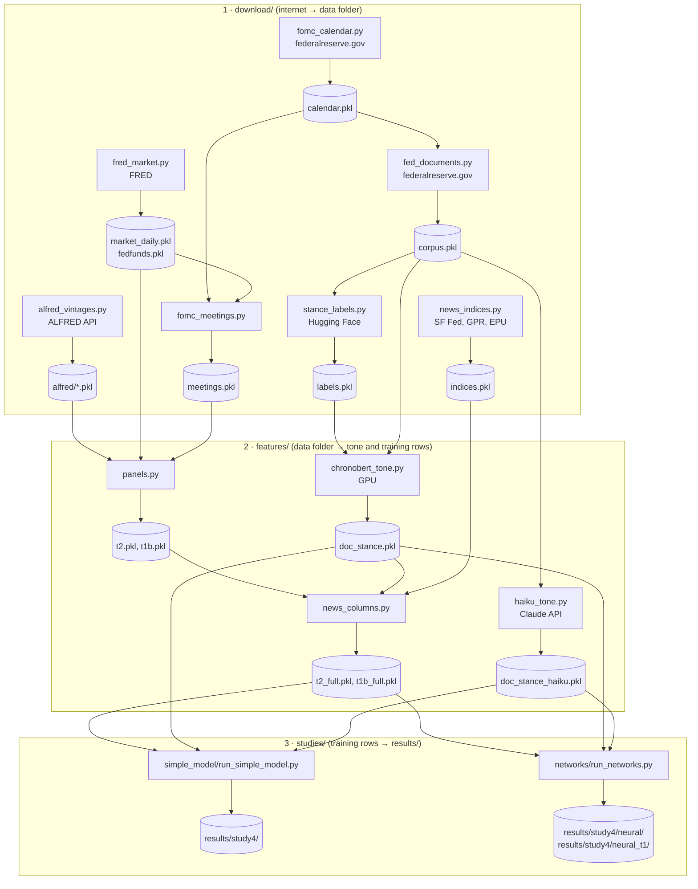

# Code guide

The code runs in three stages: **download** (internet → data folder), **build** (data folder → tone scores and
training rows), and **study** (training rows → `results/`). Every file starts with a short header saying what it
does, what it reads, what it writes and how to run it.

## Where is the data?

- **On disk**, the data folder (`<data>` below) is chosen in [`src/fed_news/config.py`](../src/fed_news/config.py):
  the environment variable `FED_NEWS_DATA` if set; else `data/` inside the repository; else `D:/fed_news` (the
  author's machine).
- **Ready-made:** `uv run python scripts/download_data.py` downloads the release zip (79 MB, 53 files), unpacks it
  into `data/` and checks every file's sha256. Every file is described in [`DATA.md`](DATA.md).
- **From scratch:** the `download/` modules fetch everything from the internet (next section). Only ALFRED needs a
  key (free, from FRED); the Haiku tone needs a paid Anthropic key.

## The pipeline

Both study runners call `features/swap_tone.py` to put one scorer's tone (Haiku "H" or ChronoBERT "C") into the
panel, so every comparison uses the same rows.

## Stage 1: what is downloaded, from where

| Data | Downloaded from | Code (`src/fed_news/`) | Saved as (`<data>/`) |
| --- | --- | --- | --- |
| Economic statistics, every published vintage (12 series) | ALFRED API, api.stlouisfed.org (free FRED key in `<data>/secrets/fred_api_key.txt`) | `download/alfred_vintages.py` | `alfred/<series>.pkl` |
| Daily target rate, effective rate, Treasury yields, VIX, oil; monthly FEDFUNDS | fred.stlouisfed.org (CSV, no key) | `download/fred_market.py` | `market_daily.pkl`, `fedfunds.pkl` |
| News sentiment, geopolitical risk, policy uncertainty (daily) | frbsf.org, matteoiacoviello.com, policyuncertainty.com | `download/news_indices.py` | `indices.pkl` |
| FOMC calendar (statement, minutes, press conference, Beige Book links) | federalreserve.gov calendar pages | `download/fomc_calendar.py` | `calendar.pkl` |
| Fed documents with full text (2,840) | federalreserve.gov | `download/fed_documents.py` | `corpus.pkl` |
| FOMC decisions 1994–2026 | built from the calendar and the target rate | `download/fomc_meetings.py` | `meetings.pkl` |
| Human hawkish / dovish / neutral labels (3,074 sentences) | huggingface.co, gtfintechlab datasets | `download/stance_labels.py` | `labels.pkl` |

Every web download is also cached in `<data>/cache/http/` (`http.py`).

## Stage 2: what is built

| File (`<data>/`) | Built by | Command | Notes |
| --- | --- | --- | --- |
| `t2.pkl` (meetings), `t1.pkl` | `features/panels.py` | `uv run python -m fed_news.features.panels` | `t1` is the original monthly cutoff, not used here |
| `t1b.pkl` (months, corrected cutoff) | `features/panels.py` | `uv run python -m fed_news.features.panels t1b` | |
| `stance/<year>.pkl`, `doc_stance.pkl` | `features/chronobert_tone.py` | `uv run python -m fed_news.features.chronobert_tone` | needs a CUDA GPU |
| `study4/sentence_labels.pkl`, `doc_stance_haiku.pkl` | `features/haiku_tone.py` | `uv run python -m fed_news.features.haiku_tone project` then `submit`, `collect` | paid API, about 23.4 million tokens |
| `t2_full.pkl`, `t1b_full.pkl` | `features/news_columns.py` | `uv run python -m fed_news.features.news_columns t1b t2` | checked on 2026-10-18: rebuilds `t1b_full.pkl` exactly |

## Stage 3: the study runs

| Step | Command (`uv run python -m ...`) | Time | Writes (`results/study4/`) |
| --- | --- | --- | --- |
| Simple model (Study 4) | `fed_news.studies.simple_model.run_simple_model` | about 5 min, CPU | `preds_T2_*.csv`, `comparison_T2.csv`, `verdict_T2.json`, `post_cutoff_T2.csv` |
| Its extra checks | `fed_news.studies.simple_model.sensitivity_checks` | minutes | `sensitivity/` |
| Network tuning (Study 4 v2) | `fed_news.studies.networks.run_networks tune --task T2 --trials 20` (and `--task T1`) | many hours | `neural/settings_*.json`, `neural_t1/settings_*.json` |
| Network forecasts and tests | `fed_news.studies.networks.run_networks forecast --task T2 --device cpu` (and `--task T1`) | under a minute with the saved forecasts; hours if they are deleted | `neural/` and `neural_t1/`: `preds_*.csv`, `metrics_neural_*.csv`, `comparison_neural_*.csv` |
| Pooled news test | `fed_news.studies.networks.pooled_news_test` | under a minute | `exploratory_pooled_news.json` |
| No-lookahead checks | `fed_news.studies.networks.check_no_lookahead` | minutes | `v2_verification.json` |
| Simple vs networks diagnostics | `uv run python audit/why_simple_model_wins.py` | under a minute | prints; saved as `audit/why_simple_model_wins.txt` |

## Read the code in this order

1. `config.py`: the data folder and every fixed setting.
2. `features/panels.py`: what one training row is (cutoff, statistics, market signals, target).
3. `models/walk_forward.py` and `models/linear.py`: the simple model's forecast loop and the ordered logit.
4. `studies/simple_model/run_simple_model.py`: Study 4 from start to finish.
5. `models/neural.py`: the LSTM and GRU, and how their input sequences are built.
6. `studies/networks/run_networks.py`: tuning, forecasting and the tests for the networks.
7. `evaluation/significance.py`: the tests behind every p-value.

## Names you will see

| Name | Meaning |
| --- | --- |
| `t2`, `t1b` | the meeting panel and the monthly panel (corrected cutoff) |
| `s_*` (16 columns), block S | economic statistics as first published |
| `m_*` (8 columns), block M | market signals: Treasury yields minus the target, target level, zero-bound flag, VIX, oil |
| `n_stance`, `n_stance_chg` | Fed tone and its change since the previous row |
| `H`, `C` | tone from Claude Haiku, tone from ChronoBERT |
| `strict` | only the 8 statistics whose first-published values exist for every row (`features/strict_columns.py`) |
| `placebo` | tone shifted by half the sample (about 16 years), so it carries no real information |
| `y_level`, `y_change`, `y_class` | target rate, change, cut / hold / hike |
| `<data>` | the data folder (above) |

## Old names (original repository and dated documents)

The design document, `docs/DEVIATIONS.md` (before its last section) and the original repository use the old names.

| Original repository | This repository |
| --- | --- |
| `collect/` | `download/` |
| `collect/alfred.py`, `market.py`, `indices.py` | `download/alfred_vintages.py`, `fred_market.py`, `news_indices.py` |
| `collect/corpus.py`, `meetings.py`, `labels.py` | `download/fed_documents.py`, `fomc_meetings.py`, `stance_labels.py` |
| `features/panel.py`, `stance.py`, `haiku_index.py`, `text_features.py` | `features/panels.py`, `chronobert_tone.py`, `haiku_tone.py`, `news_columns.py` |
| `features/stance_panel.py`, `realtime.py` (copied helpers) | `features/swap_tone.py`, `strict_columns.py` |
| `models/walkforward.py` | `models/walk_forward.py` |
| `evaluation/evaluate.py`, `stats_tests.py` | `evaluation/metrics.py`, `significance.py` |
| `studies/study4_haiku_logit/haiku_compare.py`, `study4_sensitivity.py` | `studies/simple_model/run_simple_model.py`, `sensitivity_checks.py` |
| `studies/study4_networks_v2/tune.py`, `study4_pooled.py`, `verify_v2.py` | `studies/networks/run_networks.py`, `pooled_news_test.py`, `check_no_lookahead.py` |
